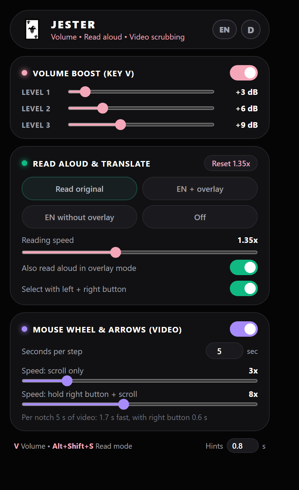

# Jester

**Louder videos. Faster scrubbing. Read exactly the text you want.**
A free, lightweight Chrome extension – no account, no ads, no tracking.

[**⬇ Download**](https://github.com/Kronedeazy/jester/releases/latest) · [Install in 1 minute](#install) · [🇩🇪 Deutsch](#-deutsch)

---

## ✨ Highlights

### 🟥 Select text with a frame – not half the page
Hold **left + right mouse button** and drag a **red frame** around any text. Jester takes *only* what's inside and reads it aloud or translates it. No more selections that run into sidebars, ads and menus.

### ⏩ Fast-forward with the mouse wheel – without skipping a thing
Scroll **up** on a video and it plays briefly at high speed until the set seconds are covered (e.g. 5 s at 5x = 1 s). You still *see* what happens instead of jumping blindly.
Hold the **right mouse button** while scrolling for turbo speed (up to 16x). Scroll **down** jumps back. Works on almost every site with a video – fullscreen or just with the mouse over the player.

### 🔊 Volume boost beyond 100 %
Press **V** for 3 adjustable boost levels (default +3 / +6 / +9 dB), **Shift+V** turns it off. Loud parts (explosions, intros) are tamed automatically while quiet voices get the full boost – and a limiter prevents distortion. The toolbar icon shows the current boost per tab.

---

## 🧰 Everything else

- **Read aloud** in the original language – German, English, Polish, Russian and Japanese are detected automatically.
- **Translate** into English or German as an overlay on the page (click to copy) or read aloud only.
- **English & German** interface – switch with one click, starts in your browser's language.
- Prefer classic selecting? Switch the red frame off and just select with the left mouse button.
- **Arrow keys ← →** jump in fullscreen, even after you clicked somewhere else on the page.
- Repeated skips add up on screen: +5s, +10s, +15s …
- **„D“ button** in the menu: demo mode that explains every feature right where it is – and lets you **change the keys**.

| Shortcut | Action |
|---|---|
| **V** / **Shift+V** | Next boost level / boost off |
| **Left + right mouse, drag** | Red frame: read / translate the text inside |
| **Mouse wheel on video** | Up = fast-forward, down = jump back |
| **Right mouse + wheel** | Turbo fast-forward |
| **← →** (fullscreen) | Jump back / forward |
| **Alt+Shift+S** | Switch read / translate mode |
| **Esc** | Stop reading |

> Keys for boost and jumping can be changed in the menu (click **D**).

## Install

1. [Download the latest release](https://github.com/Kronedeazy/jester/releases/latest) (`Jester.zip`) and unzip it to a permanent place (e.g. *Documents*).
2. Open `chrome://extensions` in Chrome.
3. Turn on **Developer mode** (top right).
4. Click **Load unpacked** and choose the unzipped `Jester` folder.
5. Pin Jester via the puzzle icon and reload open tabs (F5).

Made for Chrome; other Chromium browsers (Edge, Brave, Opera, Vivaldi) should work the same way.

## Privacy

- No data collection, no account, no ads, no analytics. Settings stay in your browser.
- Only when you **translate**, the selected text is sent to Google Translate to fetch the translation.
- Read-aloud uses the voices built into Chrome / your operating system.

## Limits

- On copy-protected streaming services (Netflix, Prime Video, Disney+) the browser does not allow the volume boost.

## Feedback

Found a bug or have an idea? Open an [issue](https://github.com/Kronedeazy/jester/issues) – feedback is welcome!

If you like Jester, a ⭐ helps others find it.

---

## 🇩🇪 Deutsch

**Lautere Videos. Schneller spulen. Genau den Text vorlesen lassen, den du willst.**
Kostenloses Chrome-Add-on – ohne Konto, ohne Werbung, ohne Datensammeln.

### Die Highlights

- 🟥 **Text per Rahmen auswählen:** Linke + rechte Maustaste halten und ziehen → roter Rahmen. Nur der Text darin wird vorgelesen oder übersetzt – statt die halbe Seite zu markieren.
- ⏩ **Mit dem Mausrad vorspulen, ohne etwas zu verpassen:** Rad hoch = das Video läuft kurz schneller, bis die eingestellten Sekunden geschafft sind (5 s bei 5x = 1 s). Rechte Taste halten + Rad = Turbo bis 16x. Rad runter springt zurück.
- 🔊 **Lauter als 100 %:** Taste **V** für 3 einstellbare Stufen (Standard +3 / +6 / +9 dB), **Shift+V** = aus. Laute Stellen werden gezähmt, leise Stimmen bekommen den vollen Boost, ein Schutz verhindert Kratzen.

### Außerdem

- Vorlesen in der Originalsprache (Deutsch, Englisch, Polnisch, Russisch, Japanisch werden erkannt).
- Übersetzen ins Deutsche oder Englische als Kasten über dem Text (Klick = kopieren) oder nur vorgelesen.
- Oberfläche auf Deutsch und Englisch – per Klick umschaltbar, startet in der Sprache des Browsers.
- Lieber klassisch markieren? Rahmen ausschalten und normal mit links markieren.
- Pfeiltasten ← → springen im Vollbild. Mehrere Sprünge werden zusammengezählt (+5s, +10s …).
- **„D“-Knopf** im Menü: Demo-Modus erklärt jede Funktion direkt an Ort und Stelle – und dort lassen sich die **Tasten ändern**.

### Installation

1. [Neueste Version herunterladen](https://github.com/Kronedeazy/jester/releases/latest) (`Jester.zip`) und an einem festen Ort entpacken (z. B. *Dokumente*).
2. In Chrome `chrome://extensions` öffnen.
3. Oben rechts den **Entwicklermodus** einschalten.
4. **Entpackte Erweiterung laden** klicken und den Ordner `Jester` wählen.
5. Über das Puzzle-Symbol anheften und offene Tabs neu laden (F5).

### Datenschutz

Keine Datensammlung, kein Konto, keine Werbung. Nur beim **Übersetzen** wird der ausgewählte Text an Google Translate geschickt.

Fragen oder Ideen? Einfach ein [Issue](https://github.com/Kronedeazy/jester/issues) schreiben.

## Version

**1.0 – first official release.** Before going public, Jester went through about 30 internal versions.

**1.0 – erste offizielle Version.** Vor der Veröffentlichung gab es rund 30 interne Versionen.

## License

MIT – see [LICENSE](LICENSE).
