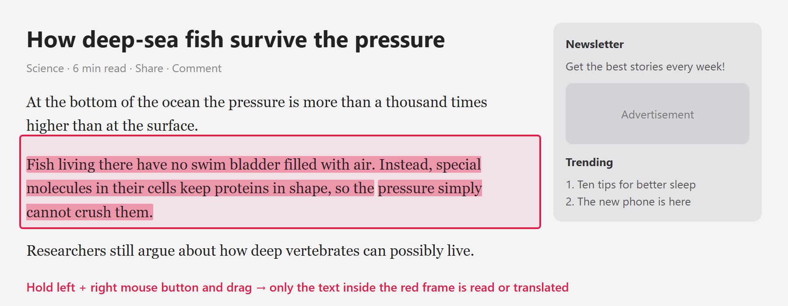

# Jester

**Louder videos. Faster scrubbing. Read exactly the text you want.**
A free, lightweight Chrome extension – no account, no ads, no tracking.

[**⬇ Download**](https://github.com/Kronedeazy/jester/releases/latest) · [Install in 1 minute](#install) · [🇩🇪 Deutsch](#-deutsch)

---

## ✨ Highlights

### 🟥 Select text with a frame – not half the page
Hold **left + right mouse button** and drag a **red frame** around any text. Jester takes *only* what's inside and reads it aloud or translates it. No more selections that run into sidebars, ads and menus.

**Works on images too:** no real text inside the frame – a screenshot, a meme, burned-in video subtitles? Jester reads the text *from the picture* (built-in text recognition, runs locally, about 1 second). The red marking behaves **just like a normal selection**: **click anywhere** to clear it (reading stops), **right-click** it for the menu to **copy** the text, **hold and drag** it to drop the text anywhere, **Esc** stops. Switching tabs doesn't interrupt reading. For text from an image the frame stays on screen as a red box. The marking disappears by itself when reading is done.

### ⏩ Fast-forward with the mouse wheel – without skipping a thing
Scroll **up** on a video and it plays briefly at high speed until the set seconds are covered (e.g. 5 s at 5x = 1 s). You still *see* what happens instead of jumping blindly.
Hold the **right mouse button** while scrolling for turbo speed (up to 16x). **Right-click while it fast-forwards** to stop right there. Scroll **down** jumps back. Works on almost every site with a video – fullscreen or just with the mouse over the player.

### 🔊 Volume boost beyond 100 %
Press **V** for 3 adjustable boost levels (default +3 / +6 / +9 dB), **Shift+V** turns it off. Loud parts (explosions, intros) are tamed automatically while quiet voices get the full boost – and a limiter prevents distortion. The toolbar icon shows the current boost per tab.

---

## 🧰 Everything else

- **Read aloud** in the original language – German, English, Polish, Russian and Japanese are detected automatically.
- **Translate** into English or German as an overlay on the page (click to copy) or read aloud only.
- **English & German** interface – switch with one click, starts in your browser's language.
- Prefer classic selecting? Switch the red frame off and just select with the left mouse button.
- **Arrow keys ← →** jump in fullscreen, even after you clicked somewhere else on the page.
- Repeated skips add up on screen: +5s, +10s, +15s … – change direction and the counter starts over.
- Reading keeps going when you switch tabs; the red marking disappears by itself when it's done.
- **„D“ button** in the menu: demo mode that explains every feature right where it is – and lets you **change the keys**.
- **Optional Microsoft voice:** a far more natural reading voice that stays clear even at 2x speed – free with your own Microsoft Azure key ([guide below](#microsoft-voice-optional)).

| Shortcut | Action |
|---|---|
| **V** / **Shift+V** | Next boost level / boost off |
| **Left + right mouse, drag** | Red frame: read / translate the text inside (or in the image) |
| **Click anywhere** | Clear the red marking, stop reading |
| **Red marking:** right-click / drag | Copy menu / drop the text anywhere |
| **Mouse wheel on video** | Up = fast-forward, down = jump back |
| **Right mouse + wheel** | Turbo fast-forward |
| **Right-click while fast-forwarding** | Stop fast-forwarding |
| **← →** (fullscreen) | Jump back / forward |
| **Alt+Shift+S** | Switch read / translate mode |
| **Esc** | Stop reading (while dragging: cancel the frame) |

> Keys for boost and jumping can be changed in the menu (click **D**).

## Install

1. [Download the latest release](https://github.com/Kronedeazy/jester/releases/latest) (`Jester.zip`) and unzip it to a permanent place (e.g. *Documents*).
2. Open `chrome://extensions` in Chrome.
3. Turn on **Developer mode** (top right).
4. Click **Load unpacked** and choose the unzipped `Jester` folder.
5. Pin Jester via the puzzle icon and reload open tabs (F5).

Made for Chrome; other Chromium browsers (Edge, Brave, Opera, Vivaldi) should work the same way.

## Microsoft voice (optional)

Jester reads with the voices built into Chrome by default. If you want a **much more natural voice** (Seraphina in German, Ava in English – both also read the other language), you can connect your own free Microsoft Azure key. Takes about 10 minutes, once.

- **Free:** 500,000 characters per month (roughly 8–10 books). With the **Free F0** tier it can never cost anything – when the quota is used up, Jester simply switches back to the normal voice.
- **Fast:** it starts playing while the audio is still loading and keeps up even at 2x speed without sounding sped up.
- **Privacy:** only while it's switched on, the text you read aloud is sent to Microsoft to create the audio. Your key stays in your browser.

**1. Create a free Azure account**
1. Open **https://signup.azure.com** (best in a private window: *Ctrl+Shift+N*).
2. Sign in with your Microsoft account or create one – any e-mail address works (Gmail too). If asked, pick **Personal account**.
3. Fill in name and phone number. Microsoft asks for a credit card **only to verify you're a real person** – with the Free F0 tier (step 2) it isn't charged.

> **Error „The selected user account does not exist in tenant 'Microsoft Services'“?** You landed on a page for existing Azure customers. Go to https://signup.azure.com instead.
> **„It looks like you already have an Azure account“?** Fine – skip to step 2.

**2. Create the speech service**
1. Open **https://portal.azure.com/#create/Microsoft.CognitiveServicesSpeechServices** (or search for *Speech services* in the portal and click *+ Create*).
2. Fill in:
   - **Subscription:** the one that's there (e.g. *Azure subscription 1*)
   - **Resource group:** *Create new* → `jester`
   - **Region:** **Germany West Central** (Europe) or **East US** – if you get *„region is currently not accepting new customers“*, pick **Sweden Central** instead
   - **Name:** anything unique, e.g. `jester-voice-4821`
   - **Pricing tier:** **Free F0** ← important!
3. Click **Review + create**, then **Create**. Wait about 30 seconds, then **Go to resource**.

**3. Copy the key**
1. In the menu on the left: **Keys and Endpoint** (or *Manage keys* on the overview page).
2. Click the copy icon next to **KEY 1**. The region is shown below (*Location/Region*).

**4. Paste it into Jester**
1. Click the Jester icon in Chrome → *Read aloud & translate* → switch on **Microsoft voice**.
2. Paste the key, choose the **same region** as in Azure, click **Test**.
3. **„Works!“** – done. From now on everything you select is read with the new voice. The menu shows how many characters you used this month.

To stop: switch *Microsoft voice* off. To remove it completely, delete the resource group `jester` in the Azure portal.

## Privacy

- No data collection, no account, no ads, no analytics. Settings stay in your browser.
- Only when you **translate**, the selected text is sent to Google Translate to fetch the translation.
- Text recognition in images runs **entirely on your computer** ([Tesseract.js](https://github.com/naptha/tesseract.js), Apache 2.0). To take the picture of the frame, Jester needs permission to capture the visible tab – that's why it asks for access to all websites.
- Read-aloud uses the voices built into Chrome / your operating system. Only if you switch on the optional **Microsoft voice** with your own key, the text being read is sent to Microsoft Azure to create the audio.

## Limits

- On copy-protected streaming services (Netflix, Prime Video, Disney+) the browser does not allow the volume boost, and the video picture can't be captured for text recognition.
- Image text recognition knows German and English.

## Feedback

Found a bug or have an idea? Open an [issue](https://github.com/Kronedeazy/jester/issues) – feedback is welcome!

If you like Jester, a ⭐ helps others find it.

---

## 🇩🇪 Deutsch

**Lautere Videos. Schneller spulen. Genau den Text vorlesen lassen, den du willst.**
Kostenloses Chrome-Add-on – ohne Konto, ohne Werbung, ohne Datensammeln.

### Die Highlights

- 🟥 **Text per Rahmen auswählen:** Linke + rechte Maustaste halten und ziehen → roter Rahmen. Nur der Text darin wird vorgelesen oder übersetzt – statt die halbe Seite zu markieren. **Auch in Bildern:** Ist im Rahmen kein echter Text (Screenshot, Meme, eingebrannte Untertitel), liest Jester den Text aus dem Bild – lokal auf deinem PC, ca. 1 Sekunde. Die rote Markierung verhält sich wie eine normale Markierung: Klick irgendwo = weg und Vorlesen stoppt, Rechtsklick = Menü zum Kopieren, gedrückt halten und ziehen = Text irgendwo ablegen, Esc = stopp. Bei Text aus einem Bild bleibt der Rahmen als rote Box stehen.
- ⏩ **Mit dem Mausrad vorspulen, ohne etwas zu verpassen:** Rad hoch = das Video läuft kurz schneller, bis die eingestellten Sekunden geschafft sind (5 s bei 5x = 1 s). Rechte Taste halten + Rad = Turbo bis 16x. Rechtsklick während des Vorspulens = sofort stoppen. Rad runter springt zurück.
- 🔊 **Lauter als 100 %:** Taste **V** für 3 einstellbare Stufen (Standard +3 / +6 / +9 dB), **Shift+V** = aus. Laute Stellen werden gezähmt, leise Stimmen bekommen den vollen Boost, ein Schutz verhindert Kratzen.

### Außerdem

- Vorlesen in der Originalsprache (Deutsch, Englisch, Polnisch, Russisch, Japanisch werden erkannt).
- Übersetzen ins Deutsche oder Englische als Kasten über dem Text (Klick = kopieren) oder nur vorgelesen.
- Oberfläche auf Deutsch und Englisch – per Klick umschaltbar, startet in der Sprache des Browsers.
- Lieber klassisch markieren? Rahmen ausschalten und normal mit links markieren.
- Pfeiltasten ← → springen im Vollbild. Mehrere Sprünge werden zusammengezählt (+5s, +10s …), bei Richtungswechsel fängt die Anzeige neu an.
- Tab wechseln unterbricht das Vorlesen nicht; die rote Markierung verschwindet nach dem Vorlesen von selbst.
- **„D“-Knopf** im Menü: Demo-Modus erklärt jede Funktion direkt an Ort und Stelle – und dort lassen sich die **Tasten ändern**.
- **Optionale Microsoft-Stimme:** viel natürlicher, auch bei 2x noch klar – kostenlos mit eigenem Microsoft-Azure-Schlüssel ([Anleitung unten](#microsoft-stimme-optional)).

### Installation

1. [Neueste Version herunterladen](https://github.com/Kronedeazy/jester/releases/latest) (`Jester.zip`) und an einem festen Ort entpacken (z. B. *Dokumente*).
2. In Chrome `chrome://extensions` öffnen.
3. Oben rechts den **Entwicklermodus** einschalten.
4. **Entpackte Erweiterung laden** klicken und den Ordner `Jester` wählen.
5. Über das Puzzle-Symbol anheften und offene Tabs neu laden (F5).

### Microsoft-Stimme (optional)

Normalerweise liest Jester mit den Stimmen, die in Chrome eingebaut sind. Wer eine **viel natürlichere Stimme** möchte (Seraphina auf Deutsch, Ava auf Englisch – beide lesen auch die andere Sprache), kann einen eigenen, kostenlosen Microsoft-Azure-Schlüssel eintragen. Dauert einmalig ca. 10 Minuten.

- **Kostenlos:** 500.000 Zeichen pro Monat (ungefähr 8–10 Bücher). Mit dem Tarif **Free F0** kann es nie etwas kosten – ist das Kontingent leer, liest Jester einfach mit der normalen Stimme weiter.
- **Schnell:** Sie fängt an zu sprechen, während der Ton noch lädt, und bleibt auch bei 2x klar.
- **Datenschutz:** Nur wenn sie eingeschaltet ist, geht der vorgelesene Text zum Erzeugen der Sprache an Microsoft. Der Schlüssel bleibt in deinem Browser.

**1. Kostenloses Azure-Konto anlegen**
1. **https://signup.azure.com** öffnen (am besten im Inkognito-Fenster: *Strg+Umschalt+N*).
2. Mit deinem Microsoft-Konto anmelden oder eins anlegen – jede E-Mail-Adresse geht (auch Gmail). Falls gefragt: **Persönliches Konto** wählen.
3. Name und Telefonnummer eintragen. Microsoft fragt eine Kreditkarte ab, **nur zur Prüfung, dass du ein Mensch bist** – mit dem Tarif Free F0 (Schritt 2) wird nichts abgebucht.

> **Fehler „Das ausgewählte Benutzerkonto ist im Mandanten 'Microsoft Services' nicht vorhanden“?** Du bist auf einer Seite für bestehende Azure-Kunden gelandet. Stattdessen https://signup.azure.com öffnen.
> **„Offenbar verfügen Sie bereits über ein Azure-Konto“?** Gut – weiter mit Schritt 2.

**2. Sprachdienst anlegen**
1. **https://portal.azure.com/#create/Microsoft.CognitiveServicesSpeechServices** öffnen (oder im Portal oben nach *Speech services* / *Sprachdienste* suchen und *+ Erstellen* klicken).
2. Ausfüllen:
   - **Abonnement:** das vorhandene (z. B. *Azure subscription 1*)
   - **Ressourcengruppe:** *Neues Element erstellen* → `jester`
   - **Region:** **Germany West Central** – kommt *„region is currently not accepting new customers“*, stattdessen **Sweden Central** nehmen
   - **Name:** irgendwas Eindeutiges, z. B. `jester-stimme-4821`
   - **Tarifstufe:** **Free F0** ← wichtig!
3. **Überprüfen + erstellen**, dann **Erstellen**. Ca. 30 Sekunden warten, dann **Zur Ressource wechseln**.

**3. Schlüssel kopieren**
1. Links im Menü: **Schlüssel und Endpunkt** (oder *Schlüssel verwalten* auf der Übersicht).
2. Neben **SCHLÜSSEL 1** auf das Kopier-Symbol klicken. Darunter steht die Region (*Standort/Region*).

**4. In Jester einfügen**
1. Jester-Symbol in Chrome anklicken → *Vorlesen & Übersetzen* → **Microsoft-Stimme** einschalten.
2. Schlüssel einfügen, **dieselbe Region** wie in Azure wählen, **Testen** klicken.
3. **„Klappt!“** – fertig. Ab jetzt wird alles Markierte mit der neuen Stimme vorgelesen. Im Menü steht, wie viele Zeichen du diesen Monat verbraucht hast.

Abschalten: Schalter *Microsoft-Stimme* aus. Ganz entfernen: im Azure-Portal die Ressourcengruppe `jester` löschen.

### Datenschutz

Keine Datensammlung, kein Konto, keine Werbung. Nur beim **Übersetzen** wird der ausgewählte Text an Google Translate geschickt. Die Texterkennung in Bildern läuft komplett auf deinem PC; für das Foto des Rahmens braucht Jester Zugriff auf alle Webseiten. Nur wenn du die optionale **Microsoft-Stimme** mit eigenem Schlüssel einschaltest, geht der vorgelesene Text an Microsoft Azure.

Fragen oder Ideen? Einfach ein [Issue](https://github.com/Kronedeazy/jester/issues) schreiben.

## Versions / Versionen

**1.2**
- Optional Microsoft voice (Seraphina / Ava) with your own free Azure key – natural sound, clear even at 2x; falls back to the normal voice automatically. Step-by-step guide above.
- Reading starts faster: the first sentence plays while it's still loading, the rest loads in the background.
- Reading never skips: if a voice breaks off, Jester picks up at the same spot; local voices read whole paragraphs.

**1.1**
- Red frame on images: reads text from pictures (local text recognition, German & English).
- The red marking now behaves like a normal selection: click anywhere = clear & stop, right-click = copy, drag = drop the text anywhere; image text shows as a red box.
- Esc while dragging cancels the frame; switching tabs keeps it reading; the marking disappears when done.
- Mouse wheel: right-click while fast-forwarding stops it; the counter starts over when you change direction.

**1.0** – first official release. Before going public, Jester went through about 30 internal versions.

*Deutsch:* **1.2** bringt die optionale Microsoft-Stimme (mit Anleitung), einen schnelleren Vorlese-Start und Vorlesen ohne Sprünge (bricht eine Stimme ab, geht es an derselben Stelle weiter). **1.1** brachte Texterkennung in Bildern, eine rote Markierung, die sich wie eine normale verhält (Klick irgendwo = weg, Rechtsklick = kopieren, ziehen = ablegen), Esc beim Ziehen = abbrechen und den Rechtsklick-Stopp beim Vorspulen. **1.0** war die erste offizielle Version nach rund 30 internen Versionen.

## How it's made

Jester is planned and tested by its maintainer and written with the help of **Claude**, Anthropic's AI assistant.
*Jester wird mit Hilfe von Claude (KI von Anthropic) geschrieben.*

## License

MIT – see [LICENSE](LICENSE).
